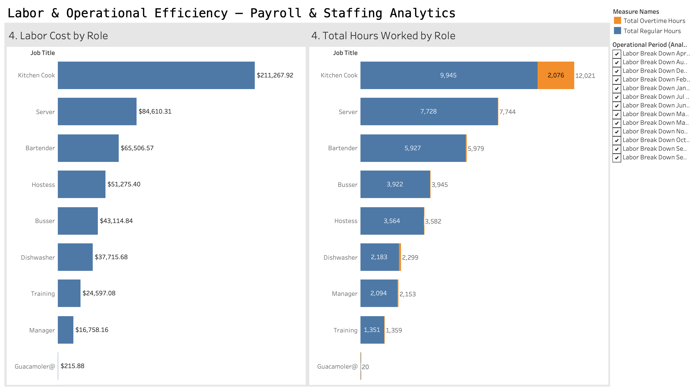
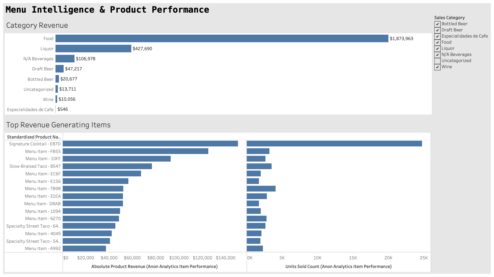
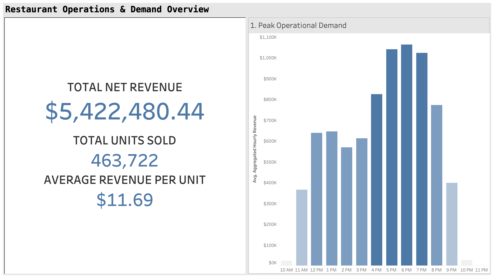
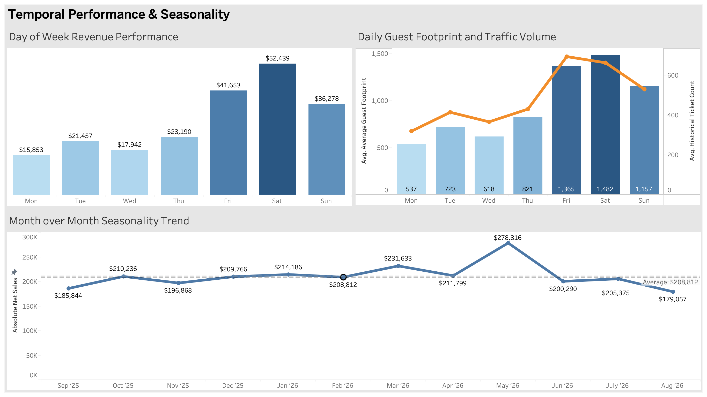

# Restaurant Operations & Menu Mix Analytics

An end-to-end restaurant analytics project using Python, SQL, and Tableau to analyze sales performance, customer demand, menu item trends, and labor efficiency.

The project uses point-of-sale (POS) and labor data to identify operational trends, evaluate menu performance, and measure how effectively labor resources are being utilized.

## Dashboard Previews

### 1. Executive KPIs & Peak Operational Demand


### 2. Seasonality & Guest Footfall


### 3. Menu Mix & Top Revenue-Generating Items


### 4. Labor Cost & Efficiency


## Business Objectives

- **Executive Performance:** Track revenue, units sold, and average revenue per unit across different reporting periods.
- **Demand & Seasonality:** Identify peak sales days, customer traffic patterns, and month-over-month trends.
- **Menu Mix & Item Performance:** Identify top-performing menu items by revenue and sales volume to support menu planning and inventory decisions.
- **Labor Efficiency:** Analyze regular and overtime hours, labor distribution by role, and sales per labor hour (SPLH).

## Key Findings

The following findings summarize the main business insights identified through the analysis:

- **Sales Performance:** Weekday versus weekend demand shows a sharp operational split: weekend dinner services (Friday through Sunday) heavily drive top-line revenue, peaking on Saturday and Sunday at roughly 42% above the weekly average, while Monday marks the slowest volume day at 57% of the baseline.
- **Customer Demand:** Guest footfall and transaction volume track closely together, showing a heavy weekend surge where Friday through Sunday traffic climbs 21% to 37% above the weekly average, contrasted against a mid-week lull bottoming out on Monday at roughly 57% of baseline traffic.
- **Menu Performance:** Signature Cocktail `E87D` (sold across both regular and happy hours) generated **15.23%** of absolute product revenue and accounted for **40.98%** of total units sold, driving strong profit margins due to low ingredient costs. Conversely, higher-priced entrées `Menu Item - FB55` and `Menu Item - 10FF` captured **12.66%** and **9.40%** of total revenue respectively, contributing significantly less to unit volume due to their higher price points.
- **Labor Efficiency:** Kitchen cooks accounted for **27.07%** of total labor hours and **87.62%** of all overtime hours across the year. While this elevated overall labor costs, it correlated with zero kitchen staff turnover (no new hires or departures). Meanwhile, host staff represented **9.07%** of total hours and just **0.79%** of overtime at $15/hr, helping anchor overall labor percentages.
- **Operational Opportunities:** September (across both 2025 and 2026) was consistently the slowest month of the year, averaging **$30,000 to $40,000 below** the annual monthly average—making it an ideal window for targeted app marketing and traffic-driving promotions. Notably, the slowest weekday shifted year-over-year: Wednesday was the lowest-grossing day in September 2025 (**$15.5k** monthly total), whereas Monday was the lowest in September 2026 (**$15.0k**), contributing to a **$6k** total sales variance between the two Septembers.

## Project Workflow

1. **Data Collection:** Exported monthly POS sales, product mix, and labor reports from Toast.
2. **Data Ingestion:** Developed Python scripts to automate the ingestion of raw Toast CSV exports into a Neon PostgreSQL database.
3. **Data Cleaning & Transformation:** Used SQL to clean, aggregate, and organize raw transaction and labor data into analytical views.
4. **Data Modeling:** Created analytical SQL views to structure datasets and support reporting.
5. **Data Analysis:** Queried structured datasets to evaluate revenue trends, menu performance, customer demand, and labor efficiency.
6. **Visualization:** Connected Tableau to PostgreSQL to develop dashboards highlighting key operational metrics and business insights.

## Data Architecture & Anonymization

Raw POS and labor data was stored in a Neon PostgreSQL database and transformed into analytical views before being connected to Tableau.

- **Data Modeling:** Used SQL to aggregate raw transaction and labor data into analytical views, including:
  - `analytics_item_performance`
  - `analytics_product_menu_mix`
  - `analytics_weekday_seasonality`
  - `analytics_labor_by_role`
- **Data Privacy:** Applied SQL `CASE` statements and MD5 hashing to anonymize proprietary menu item names while preserving individual item records, revenue values, and performance rankings.

## Repository Structure

```text
restaurant-operations-analytics/
│
├── images/
│   ├── 01_executive_kpis.png
│   ├── 02_seasonality_demand.png
│   ├── 03_menu_mix.png
│   └── 04_labor_efficiency.png
│
├── sql/
│   └── anonymize_views.sql
│
├── tableau/
│   └── Restaurant_Analytics_Public.twbx
│
├── python/
│   └── upload_pipeline_public.py
│
├── .gitignore
└── README.md